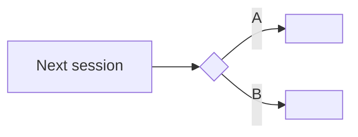

# Checkpoint

A checkpoint freezes what the session knows at a task boundary so nothing depends on the chat surviving. It is evidence and a decision snapshot, never approved intent.

## Activation boundary

Run only at a task boundary (a task just finished, or before a handover, closeout or model switch). If work is mid task, say so and stop: finish the step first. Never run or suggest compaction mid task. Editing or testing this skill is not invocation.

## Workflow

1. Attached files: if the human attached any file, open it first and write `YOUR INPUT IN THIS FILE` with their own words quoted, before anything else.
2. Measure context with a script, never by feel:
   - copy the current session file to scratch first (never read the live file in place): Claude sessions live in `~/.claude/projects/<project slug>/<session id>.jsonl`, Codex sessions in `~/.codex/sessions/YYYY/MM/DD/rollout-*.jsonl`, often compressed as `rollout-*.jsonl.zst` or moved to `~/.codex/archived_sessions/`. For Codex, make the scratch copies with `python3 <PLUGIN_ROOT>/scripts/zst_to_scratch.py --out <scratch>/raw --thread <thread id>` and pass the paths of its `ARGS:` line, in that order, to every script in steps 2, 2a and 4 (v0.1.4);
   - run `python3 <PLUGIN_ROOT>/scripts/session_metrics.py --run-at "$(date -u +%Y-%m-%dT%H:%M:%SZ)" --out <scratch>/metrics.csv <scratch copy>`;
   - report `max_context_per_turn`, turns and the message counts from the CSV columns `user_messages`, `user_messages_mid_turn`, `slash_commands` (settings commands such as `/model`, never counted as messages since v0.1.2) and `assistant_messages`, citing the CSV path. Never count messages by hand: a hand count once took the marker `[Request interrupted by user]` for a human message.
2a. Human input list, mandatory, before any table is drafted (v0.1.3). Run, in one call with every raw file of the conversation:
   `python3 <PLUGIN_ROOT>/scripts/list_inputs.py <raw file 1> [<raw file 2> ...] --md <scratch>/inputs.md --jsonl <scratch>/inputs.jsonl --prohibitions`
   Paste its last line, `HUMAN INPUT ROWS: <n> (...)`, into the INPUTS line of the output block. That list is the only source for what the human said: typed messages, messages typed while a turn ran, card answers, card dismissals, slash commands, interrupt markers, attachments, and any text that survives only as a queue line (kind "enqueue only, NOT delivered"). Never build it by hand or from a filtered grep: the v0.1.2 checkpoint lost a dismissed card that way.
   - **Coverage rule:** every row of its Table 1 appears in checkpoint table 1 (Intent evolution), or is named in GAPS with its label (for example `F1 L1076`) and the reason it was left out. No other way to leave a row out.
   - A dismissed card is written as "dismissed", with the script's note. It is never written as a rejected option unless a later message from the human says so. When the note says "possible mistranscription", say that.
   - A row marked "enqueue only, NOT delivered" is written as typed but never delivered. It is never an approval, because the model never received it.
   - **Quote rule:** a quote of 200 characters or fewer is the whole message, never cut (priority and frustration words are part of it). A longer quote is cited as its first 8 words, `[...]`, and its last 8 words, the form Table 1 uses. Run `locate_quote.py` on each part; both parts must fall in the same USER block. `check_quotes.py` (v1.1.0) checks each part separately.
3. Independent verifier: ask the human for a verifier run (a different model or a fresh session, for example a model from another vendor) that reads the checkpoint and the session record and marks each table row CONFIRMED, WRONG or UNSURE. Do not mark your own checkpoint verified.
4. Produce the decision tables (1 to 4, 4a, 4b) and the four fixed sections below. Every quoted line reference comes from `locate_quote.py` run on the conversation record (build it with the `conversation-record` skill workflow, step 3, when none exists). If the conversation was resumed into a new session file, pass every file of it in one call: `make_record.py <file1> <file2> ... <record.md>` (one record, files tagged F1, F2).
5. Quote check, mandatory: save the drafted tables as `CHECKPOINT.<YYYY-MM-DD-HHMM>.md`, then run `python3 <PLUGIN_ROOT>/scripts/check_quotes.py <that draft> <record.md>`. The script removes every table row whose double quoted text is not found in the record at the cited line (or anywhere, when no line is cited) and writes `<name>.checked.md`. The delivered checkpoint is the `.checked.md` file, never the unchecked draft. List the removed rows and their quotes in a `GAPS` line of the checkpoint. A quote the script removed is never retyped to get it through: fix it from the record or leave it out.
6. Write the checkpoint as a new file beside the task's work (the `.checked.md` file from step 5). Never overwrite an earlier checkpoint.
7. Post every section in the chat in full (tables 1 to 4, 4a meta decisions, 4b next decisions as branches with its mermaid block, sections 5 to 8), never only a link or a summary, then a clickable link to the file relative to the session root (v0.1.5: the human sees and edits the record in the chat).

## The decision tables (mandatory before any handover)

### 1. Intent evolution

Rows come only from the `list_inputs.py` list of step 2a, one row per human input, in time order (coverage rule above). Never rebuild intent from memory or from the AI's own messages.

| # | When (record line) | What the human wanted | Quote | Source |
| --- | --- | --- | --- | --- |

### 2. Decisions taken

| # | Decision | Who decided | Quote | Record line | Status (FACT / ASSUMPTION with source / PROPOSAL, unapproved) |
| --- | --- | --- | --- | --- | --- |

### 3. Pending decisions

| # | Question | Options A/B/C | Draft answer | Why it matters | Source |
| --- | --- | --- | --- | --- | --- |

Each row is an A/B/C card (v0.1.5): options A, B, C plus other, each option with what changes if chosen, and the draft answer written `Draft answer: X`, never `Recommendation: X`.

### 4. Probable future decisions

| # | Likely decision | Trigger | Assumption | Assumption source | Confidence |
| --- | --- | --- | --- | --- | --- |

Every row in tables 3 and 4 names its assumption and its source; an unsourced row is deleted, not shipped.

### 4a. Meta decisions (how the human chose to decide) (v0.1.5)

| # | Meta decision | Source (USER block, record line or message time) | Status |
| --- | --- | --- | --- |

A meta decision is a rule about deciding that the human applied in this session (for example: read only first, numbers set in advance as stop conditions, scratch first then a new versioned folder, an independent model checks the work). Draw each row from their own messages and cite them; a pattern the AI inferred is labelled `INFERENCE` with its source. Fixed word when none: `NONE FOUND`.

### 4b. Next decisions as branches (v0.1.5)

Predictions, not facts. Build the branches only from table 3 (pending decisions), table 4 (probable future decisions) and the human's approved goals file when one exists; name which one each branch comes from.

1. A mermaid flowchart: one start node (`Next session`), one diamond per open decision, one edge per option labelled with the option letter, and the likely next step after each option.



2. A table with one row per branch:

| Branch | Choice | Likely outcome | Confidence (High / Medium / Low) | Source of the prediction |
| --- | --- | --- | --- | --- |

Every prediction names its source (a table 3 or 4 row, a file and line, or a USER block); a branch with no source is deleted, not shipped. The flowchart and the table carry the same branches.

**Silence is never acceptance (v0.1.3).** A decision that rests on the human not replying is written `PROPOSAL, unapproved`, never `ASSUMPTION that the human accepts`. It never enters section 7 as an approval and never authorizes the next action.

## Citation rule (v0.1.2)

Every record line cited for the human's words points to a block headed `USER` (`## L<n> · USER` or, in a multi file record, `## F<k> L<n> · USER`) whose text is their typed message, or their answer to a decision card (an `AskUserQuestion` answer arrives as a `tool_result` inside a USER block: cite that block and write `(card answer)` beside the line). When `locate_quote.py` returns several hits, cite the USER block. Never cite a `queue-operation` block, a `DUPLICATE` pointer, or a block headed `COMPACT_SUMMARY (AI)` or `META (AI)` as the human's words: those are written by the harness. Only when their message exists solely as an `attachment` block with a `queued_command` (typed mid turn), cite that block and write `(queued mid turn)` beside the line.

## The four fixed sections (mandatory, v0.1.2)

Each section is always present. When a section has nothing in it, write the fixed word given below; never omit the section.

### 5. Scope of "Decisions taken"

| Field | Value |
| --- | --- |
| Covers | record `<file>`, blocks L<a> to L<b>, `<first timestamp>` to `<last timestamp>` |
| Not covered | decisions taken before L<a>, in other sessions, or in other harnesses (name them) |

Inherited decisions this session relies on (fixed word when none: `NONE`):

| # | Decision (short) | Who decided | Where it lives (path and line, or record and block) |
| --- | --- | --- | --- |

### 6. Permitted next action for the AI

| Field | Value |
| --- | --- |
| Permitted now | `WAIT` or exactly one action |
| Authorized by | quote plus USER block, or `NOTHING: no USER block authorizes an action` |
| Needs new approval first | everything else the next step could touch |

Rule: if no USER block authorizes a specific action, the value is `WAIT`. A proposal written by the AI is never an authorization.

### 7. Approvals consumed and open

| # | Approval (quote) | USER block | Scope it covered | Status: CONSUMED / OPEN / EXPIRED | Consumed by (record line of the action) |
| --- | --- | --- | --- | --- | --- |

Then one line: `OPEN APPROVALS: <n>` (write `OPEN APPROVALS: 0` when none). Approval is per action: one consumed approval never covers a later action.

### 8. Do not list (consolidated)

| # | Do not | Quote | Source (USER block, or standing rule file and line) |
| --- | --- | --- | --- |

One list for every forbidden action that applies to the next step, gathered from the whole record and the standing rules; the fixed word when none is `NONE FOUND`.

**Opening block rule (v0.1.3).** Take every sentence listed under "Prohibition candidates in the opening human message" in the `list_inputs.py` output as one row, verbatim, each citing the USER block it comes from (the first typed row). Leave one out only by naming it in GAPS. Every row cites a USER block, or a standing rule file with its line; a row with no citation is deleted. A restriction the AI wrote for itself is not a row here (put it in table 2 as an AI self restriction).

## Output block

```text
CHECKPOINT: <link to the .checked.md file>
QUOTES: kept <n>, removed <n> (see GAPS)
CONTEXT: max_context_per_turn=<n> (metrics CSV <path>)
INPUTS: HUMAN INPUT ROWS: <n> (<breakdown pasted from the script>); in table 1: <n>; named in GAPS: <n>
VERIFIER: REQUESTED | CONFIRMED <who> | NOT_AVAILABLE
TABLES: intent <n rows>, decisions <n>, pending <n>, future <n>, meta <n>, branches <n>
CHAT: every section posted in full (yes | no, with reason)
SCOPE: L<a> to L<b>; inherited decisions <n>
AI NEXT: WAIT | <one action> (authorized by <USER block>)
APPROVALS: consumed <n>, open <n>
DO NOT: <n> items
NEXT: <one action for the human>
```

## Shared plugin rules (continuity v0.1.0)

- YOUR INPUT IN THIS FILE: when the human attaches a file, first extract and quote their own input from it (their words, decisions and corrections) under the heading `YOUR INPUT IN THIS FILE`, before any analysis.
- Line references: every line number cited for a quote comes from `python3 <PLUGIN_ROOT>/scripts/locate_quote.py <record> "<quote>"`. Never type a line number by hand (in testing, 8 of 44 hand typed line numbers were wrong). If the script exits non zero, the quote is not in the record: fix the quote or drop it.
- Never overwrite: write a new versioned file `<name>.<YYYY-MM-DD-HHMM>.<ext>` (time from `date +%Y-%m-%d-%H%M`). Never delete, move or rename an existing file.
- Every assumption names its source: `ASSUMPTION, derived from <file, sentence, search result, or "nothing, I filled a hole">`.
